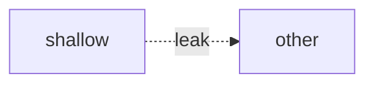

# Diagrams

Pick the pattern that carries the point. Mix Mermaid and hand-built. If a diagram needs a paragraph to be understood, redraw it.

## When to use which

| Shape | Tool |
| --- | --- |
| Call graph, dependency, resolve tree, sequence | Mermaid `flowchart` / `sequenceDiagram` · `theme: neutral` · `curve: basis` |
| Short interface vs deep implementation | Hand-built **mass** columns |
| Isolation / assurance grades | Hand-built **stack** (`border-l-4` bands) |
| Ordered states / pipeline | Hand-built **horizontal row** |
| Middleware onion | Nested / indented boxes |
| Leak across a seam | Red dashed edge or red callout — not a new colour system |

Wrap Mermaid in `div.rounded-lg.border.border-slate-200.bg-white.p-5` + `<pre class="mermaid">`. Never put `language-*` on that pre.

Mass columns and horizontal state rows are **full width**. Do not park them in one half of a two-column grid next to another figure.



## Mass (interface short / implementation deep)

Three (or fewer) **full-width** columns. Not 112px sticks.

```html
<div class="grid gap-4 sm:grid-cols-3">
  <div class="flex flex-col gap-2">
    <div class="rounded-md border-2 border-slate-900 bg-white px-4 py-3">
      <p class="font-mono text-[11px] uppercase tracking-wider text-slate-500">interface</p>
      <p class="mt-1 font-mono text-sm font-medium">load_and_lock(…)</p>
    </div>
    <div class="flex flex-1 flex-col rounded-md border-2 border-slate-900 bg-slate-900 px-4 py-4 text-stone-50">
      <p class="font-mono text-[11px] uppercase tracking-wider text-slate-400">implementation</p>
      <ul class="mt-3 space-y-2 text-[15px] leading-snug text-stone-100">
        <li>读 YAML</li>
        <li>digest</li>
      </ul>
    </div>
    <p class="text-sm text-slate-500">Core 1</p>
  </div>
</div>
```

Forbidden: `w-28` + `text-[10px] uppercase` + centered Chinese on a gradient. Lists are left-aligned, 15px, sentence case.

## Stack (grades / layers)

Horizontal bands, thicker = the one you are teaching.

```html
<div class="flex items-stretch gap-4 rounded-lg border-l-4 border-ikb bg-indigo-50/60 px-5 py-6">
  <div class="w-16 shrink-0 font-mono text-sm font-semibold text-ikb">L1</div>
  <div>…</div>
</div>
```

Muted neighbours: `border-slate-300` / `opacity-80`.

## Horizontal state row

Success path left → right. Fail/cancel as a dashed note under the row, not extra Mermaid edges.

```html
<ol class="flex min-w-max items-stretch">
  <li class="flex items-center">
    <span class="rounded-md border-2 border-slate-900 bg-white px-3 py-2 font-mono text-[13px] leading-none">created</span>
    <span class="mx-1.5 font-mono text-slate-400">→</span>
  </li>
  <!-- … -->
  <li><span class="rounded-md border-2 border-ikb bg-ikb px-3 py-2 font-mono text-[13px] text-white">terminal</span></li>
</ol>
```

Wrap in `overflow-x-auto`. Terminal / cleanup may use the dark or IKB pill.

## Other hand-built (use when the point needs them)

- **Duo** — two equal cards; the answer side `border-2 border-slate-900`. Good for L0 vs L1, provide vs on.
- **Before / after** — two columns, each diagram ~320px tall so they sit side by side without a page scroll. Variety: do not make every pair the same pattern.
- **Boxes + SVG arrows** — when Mermaid’s layout fights you; “after” is one thick-bordered deep box with faded internals.
- **Call-graph collapse** — nested boxes before; one box with faded inner calls after.
- **Cross-section** — `h-12 border-l-4` bands (same family as **stack**). Thin = shallow hop; thick = consolidated responsibility.

## Legend (optional, header)

Solid box = module · dashed line = seam · red = leak · thick dark = deep module.

## Architecture review

Only if the user asked for an architecture review (the `/improve-codebase-architecture` shape).

Use exactly: **module**, **interface**, **implementation**, **depth**, **deep**, **shallow**, **seam**, **adapter**, **leverage**, **locality**.

Never substitute: component / service / unit (for module) · API / signature (for interface) · boundary (for seam) · layer / wrapper (for module).

Each candidate is one `<article>`:

- Title that names the deepening
- Badge: `Strong` emerald / `Worth exploring` amber / `Speculative` slate, plus a dependency tag (`in-process` / `local-substitutable` / `ports & adapters` / `mock`)
- Files — `font-mono text-sm`
- Before / after (centrepiece)
- Problem one sentence · solution one sentence · wins ≤6 words in glossary terms (`locality: …`, `leverage: …`)
- ADR callout (amber) only if it contradicts an existing ADR

End with **Top recommendation**: one larger card, candidate name, one sentence why, anchor to its card.

No intro essay — header + legend, then candidates. Still use this file’s visuals and [style.md](style.md) chrome. Do not fall back to a generic dashboard.
