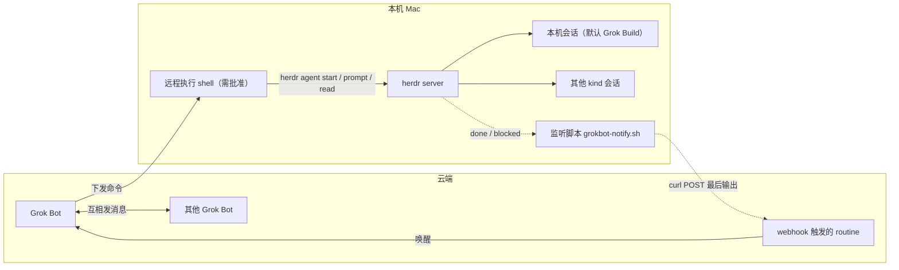

# herdr-grokbot

云端 Grok Bot 通过本机 [herdr](https://github.com/herdrdev/herdr) 驱动本机编程 agent（默认 **Grok Build**）。Agent 完成或卡住时，监听脚本把最后输出 POST 给 webhook routine，再唤醒 Grok Bot。

herdr 是 Rust 写的、面向编程 agent 的终端复用器。文档 <https://herdr.dev/docs>。server 托管 pane，识别状态 `idle` / `working` / `blocked` / `done` / `unknown`。控制面是 CLI，本地 unix socket `~/.config/herdr/herdr.sock`（每行一个 JSON）。没有 HTTP API，不会主动发 webhook。

动手前先跑 `herdr --skill`，读当前二进制自带的官方 agent 指南。已安装的 `herdr` 是命令语法的权威。官方指南假定调用方在 pane 内（`HERDR_ENV=1`）。本 recipe 是云端 Bot 经用户批准的远程 shell 调本机 CLI，不在 pane 里，因此没有 `HERDR_ENV`。

## 默认 agent（可覆盖）

| 项 | 默认 | 说明 |
| --- | --- | --- |
| herdr `--kind` | `grok` | 检测清单里 `grok-build` 是别名，CLI 用 `grok` |
| agent 名 | `gb1` | 须匹配 `[a-z][a-z0-9_-]{0,31}`，且在存活 agent 中唯一 |
| 可选集成 | `herdr integration install grok` | SessionStart hook；状态仍主要靠屏幕检测 |

用户说「用 Codex / Claude / …」时，把 `--kind` 和 agent 名换成对应值（例如 `codex` + `cx1`）。不确定时跑 `herdr agent` 看本机支持的 kind 列表，不要臆造。原生参数一律放在 `--` 后面，且不要改用户家目录里的全局配置文件来迁就某次任务。

## 架构



循环：Grok Bot 发 prompt → 本机 agent 干活 → `done` / `blocked` → 监听脚本 POST → routine 唤醒 Grok Bot → 决定继续、转给别的 Bot，或告诉用户。

## 不要

- 每次远程 shell 都要用户批准。
- pane id 从 JSON 取（`workspace create` / `tab create` 的 `.result.root_pane.pane_id`，例如 `w9:p1`）。不要猜，不要按侧边栏顺序推。
- **多任务 / 多会话：同一 workspace（space）下开不同 tab，不要每个任务新建一个 workspace。** 一串 issue 并行时 workspace 会爆炸，难找也难关。
- 批准框先 `agent read` 看命令，确认安全再 `send-keys … y`。
- 批准框之外不要往输入框发字符。输错用 `ctrl+u` 清行。
- 需要换模型时用该 agent 自己的 CLI 参数（放在 `--` 后），不要改用户全局配置。
- webhook URL 和 Authorization 只放 `~/.config/herdr/grokbot-webhook.env`，不要贴进聊天。
- Cursor Cloud Agent 走各自的 skill，不用这条回路替代。

## 搭建

1. 安装：

```bash
curl -fsSL https://herdr.dev/install.sh | sh
herdr integration install grok   # 默认 Grok Build；换 kind 时改装对应 integration
```

2. 常驻 server。直接 `herdr server &` 会随启动它的 shell 退出而死：

```bash
launchctl submit -l dev.herdr.server -o /tmp/herdr-server.log -e /tmp/herdr-server.log -- ~/.local/bin/herdr server
herdr agent list
```

3. **布局：优先同一 workspace 的不同 tab。** herdr 里 workspace ≈ 侧边栏的 space；tab 是 space 里的标签页。

- **第一次**（或还没有合适的 workspace）：建一个 workspace，记下 `.result.workspace`（如 `w9`）和 `.result.root_pane.pane_id`：

```bash
herdr workspace list
herdr workspace create --cwd <dir> --label <workspace-label> --no-focus
# → .result.workspace / .result.tab / .result.root_pane.pane_id
```

- **同一工作流里的第 2、第 3… 个任务 / 会话**：复用已有 workspace id，只加 tab（不要再 `workspace create`）：

```bash
herdr tab create --workspace <workspace-id> --cwd <dir> --label <task-label> --no-focus
# → .result.tab / .result.root_pane.pane_id
```

约定：并行 issue（如 ageval `#251`/`#252`/`#255`）共用一个 workspace（例如 label `ageval-parallel`），每个 issue 一个 tab + 一个 agent 名（`gb251`、`gb252`…）。只有用户明确要求隔离、或 cwd/环境完全无关时，才新开 workspace。

4. 启动本机 agent（默认 Grok Build）。原生参数必须放在 `--` 后面。`agent start` 要的是已有的空闲 shell pane，不会自己建 pane：

```bash
herdr agent start gb1 --kind grok --pane <pane>
# 用户指定其他 kind 时，例如：
# herdr agent start cx1 --kind codex --pane <pane> -- -m gpt-5.5 --sandbox workspace-write --ask-for-approval on-request
```

5. 新目录首次可能弹 trust / 确认：`start` 返回 `agent_not_ready`（blocked）。名字仍可用于 `read` / `send-keys`。键名用大写 `Enter`，小写 `enter` 无效：

```bash
herdr agent send-keys gb1 Enter
```

6. 发任务。`--wait` 等到第一次落到 `done` 或 `blocked`（也会落到 `idle`）。超时单位毫秒：

```bash
herdr agent prompt gb1 "..." --wait --timeout 600000
herdr agent read gb1 --source recent-unwrapped --lines 60
```

7. 批准框：`prompt` 返回 `blocked` → 先 read 看命令 → 确认安全后：

```bash
herdr agent send-keys gb1 y
```

紧接着的 `herdr agent wait gb1` 会立刻返回旧的 `blocked`（当前状态已经匹配，wait 不会等它变化）。sleep 几秒，再用 `herdr agent get gb1` 轮询 `.result.agent.agent_status`。

## 状态

状态靠读屏幕，可能停在 `unknown`。`unknown` 只说明分不了类，不能当成完成。

- `idle`：可以输入，且该 tab 已在聚焦的 herdr UI 里看过。
- `done`：后台工作结束、UI 还没看过，底层与 `idle` 相同。在 UI 里看过该 tab 之后变成 `idle`。CLI read 不会把它标成已看。
- `blocked`：批准框或提问。
- `working`：正在跑。

CLI 错误是 stderr 上的 JSON，退出码 1。

## 回调

Grok Bot 建一个 webhook 触发的 routine。用户从 routine 面板复制 Webhook URL 和 Authorization header，写到 `~/.config/herdr/grokbot-webhook.env`：

```bash
GROKBOT_WEBHOOK="https://…"
GROKBOT_AUTH="Bearer <sender-key>"
```

值必须加引号。`GROKBOT_AUTH` 用 `Bearer ` 前缀；脚本也会在缺前缀时自动补上。

然后在本机跑（参数是 agent 名，默认 `gb1`）：

```bash
# 相对本 skill 目录
scripts/grokbot-notify.sh gb1
```

脚本轮询 `herdr agent get`。状态变成 `done` 或 `blocked` 且与上次不同时，用 `agent read --source recent-unwrapped --lines 60` 取最后输出，POST JSON `{agent, status, text}`。`GROKBOT_AUTH` 若带 `Authorization: ` 前缀，脚本会去掉再放进 header。空状态（server 还没起来）每 10 秒重试，其余每 5 秒看一次。

herdr 不会主动 webhook，所以这条回路用轮询。下列项可能仍未在你这台机器上验证：

- webhook 实际 POST 能唤醒 routine
- 用插件事件 `pane.agent_status_changed` 代替轮询
- 各 agent 自带的 notify / Stop hook 作为替代

## 操作要点（给执行这条 skill 的 Bot）

1. 先确认本机 herdr server 活着（`herdr agent list`），再布局 / start。
2. **多任务先 `workspace list`：有可复用的就 `tab create --workspace …`，没有才 `workspace create`。禁止「一个任务一个 workspace」。**
3. 默认 `--kind grok`、agent 名 `gb1`（并行时用唯一名如 `gb251`）；用户点名其他栈时再改，并同步改 notify 脚本参数（可每 agent 一个 LaunchAgent）。
4. 每条远程 shell 都走用户批准；批准框内容先 read 再决定是否 `y`。
5. 任务结束后若用户已配 webhook，提醒本机保持 `grokbot-notify.sh` 在跑；未配则读屏后把摘要直接回给用户。
